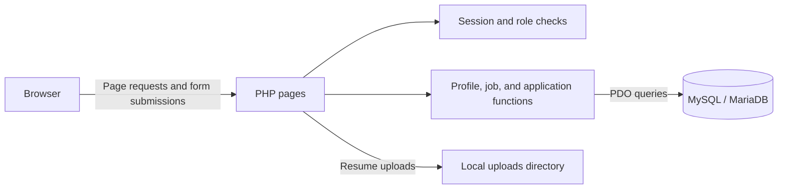

# JobSystem

A PHP and MySQL job portal where employers manage job openings and jobseekers find opportunities, submit applications, and track their progress.


## Overview

JobSystem uses the **workwithoutlimits** brand throughout its interface. It supports an inclusive hiring workflow by letting jobseekers record their accessibility needs and employers describe the accommodations available in their workplaces.

The application provides separate dashboards for employers and jobseekers, with profile management, job listings, résumé uploads, and application status tracking.

## Features

### Jobseekers

- Create an account and complete a personal profile.
- Record skills, accessibility needs, and preferred work arrangements.
- Upload a résumé in PDF, DOC, or DOCX format, up to 5 MB.
- Search active listings by keyword, work arrangement, and employment type.
- View job details and calculated match scores.
- See recommended jobs on the dashboard.
- Apply to openings and track pending, shortlisted, or rejected applications.
- Receive duplicate-application checks when applying.

### Employers

- Create and maintain a company profile.
- Post openings with descriptions, required skills, work arrangements, and accessibility features.
- Edit listings and manage their active or closed status.
- Review applicants and access their uploaded résumés.
- Shortlist or reject applications.
- View job and application summaries on the dashboard.

## Tech Stack

| Area | Technology |
| --- | --- |
| Backend | PHP |
| Database | MySQL / MariaDB |
| Database access | PDO with prepared statements |
| Frontend | HTML, CSS, and JavaScript |
| Styling | Bootstrap through the Bootswatch Brite theme |
| Icons | Bootstrap Icons |
| Authentication | PHP sessions and password hashing |
| File storage | Local résumé uploads |
| Local development | XAMPP and phpMyAdmin |

## Architecture



PHP renders the application pages and handles form submissions. Shared functions manage profiles, listings, applications, and job matching. JavaScript updates filtered job listings without reloading the whole page.

The database contains five main tables: `users`, `seeker_profiles`, `employer_profiles`, `job_posting`, and `applications`.

## Getting Started

### Requirements

- [XAMPP](https://www.apachefriends.org/) with Apache and MySQL/MariaDB
- PHP 7.4 or higher with the PDO MySQL extension enabled
- A modern browser
- Internet access for the CDN-hosted theme and icons

### 1. Download the project

Clone the repository into your XAMPP `htdocs` directory using `jobsystem` as the folder name:

```bash
git clone https://github.com/shanshan-3/jobpostingsystem.git jobsystem
```

For a typical Windows installation, the resulting location is:

```text
C:\xampp\htdocs\jobsystem\
```

You can also download the repository as a ZIP and extract it into that folder.

### 2. Import the database

1. Start **Apache** and **MySQL** in the XAMPP Control Panel.
2. Open `http://localhost/phpmyadmin`.
3. Open the **Import** tab and select `jobsystem.sql`.
4. Run the import. The script creates and selects the `jobsystem` database and loads its tables and sample records.

**Warning:** The SQL script drops and recreates the application tables. Import it into a fresh local setup, or back up existing data first.

### 3. Configure the connection

Open `config/database.php` and set the connection variables for your local database:

```php
$host = 'localhost';
$dbname = 'jobsystem';
$username = '';
$password = '';
```

Fill in `$username` and `$password` with your database credentials. Keep those credentials private.

### 4. Open the application

Visit:

```text
http://localhost/jobsystem/
```

Register a new employer or seeker account and complete its profile.

The project runs directly through Apache and PHP. No Composer or npm installation is required.

## Usage

To try the hiring workflow:

1. Register an **employer** account and complete its company profile.
2. Post a job opening.
3. Register a separate **seeker** account and complete its personal profile.
4. Browse jobs and submit an application.
5. Sign in as the employer to shortlist or reject the applicant.
6. Sign in as the seeker to check the updated application status.

## Project Structure

```text
jobpostingsystem/
├── assets/          # Shared CSS and JavaScript
├── auth/            # Registration, login, and logout
├── config/          # PDO database connection
├── employer/        # Company profiles, listings, and applicants
├── functions/       # Shared profile, job, and application logic
├── includes/        # Shared layout and session helpers
├── jobseeker/       # Profiles, job browsing, and applications
├── index.php        # Landing page
└── jobsystem.sql    # Database schema and sample records
```

The résumé upload handler creates an `uploads/` directory when needed. Apache must have permission to create and write to it.
